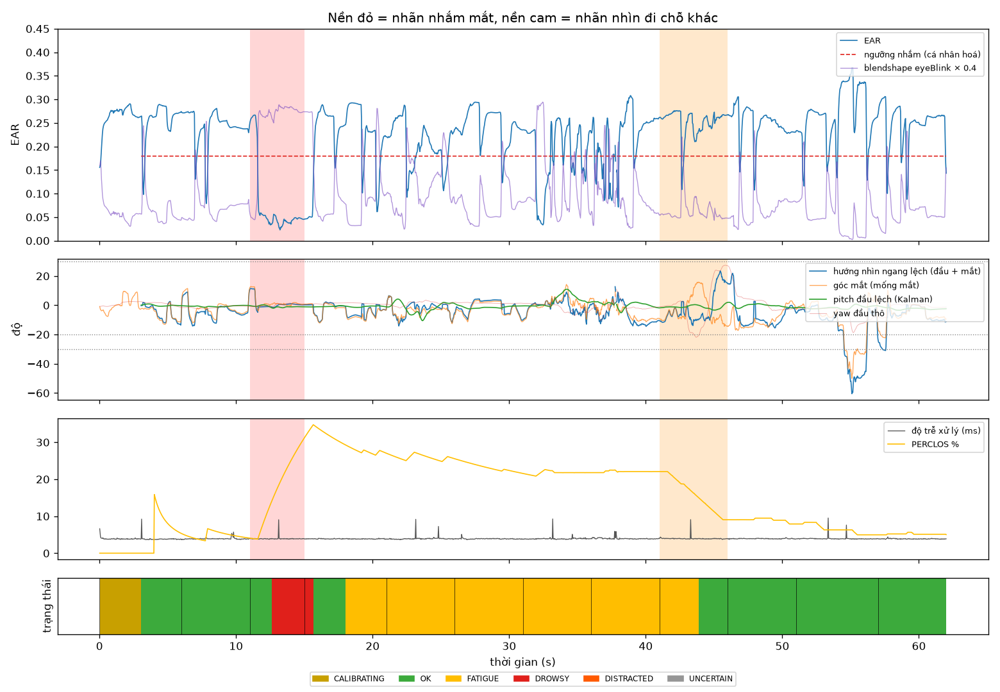

# Kết quả đánh giá: `failure_bach_20261016_192721.mp4`

- 1858 frame, 62.0 s, FPS ghi thực tế 29.7, thấy mặt 99.9% frame, hiệu chuẩn xong lúc 3.1 s

## 1. Mắt nhắm/mở theo frame

Bỏ 0.7 s đầu mỗi đoạn (thời gian phản ứng), bỏ đoạn chớp mắt tự do/ngáp/quay đầu.

| Phương pháp | Precision | Recall | F1 | Accuracy | n frame |
|---|---|---|---|---|---|
| Hệ thống: EAR cá nhân hoá VÀ blendshape (cả 2 mắt) | 0.51 | 1.00 | 0.68 | 0.93 | 1407 |
| Chỉ blendshape eyeBlink > 0.5 (MediaPipe) | 0.61 | 1.00 | 0.76 | 0.95 | 1407 |

## 2. Theo sự kiện (cảnh báo có kịp không)

| Đoạn | Mong đợi | Bắt được | Trễ từ lúc có lời nhắc (s) |
|---|---|---|---|
| (van deo kinh) NHAM MAT 4 giay | DROWSY | ✅ | 1.62 |
| QUAY HAN SANG BEN (>60 do) | DISTRACTED | ❌ | – |

- Tỉ lệ bắt sự kiện: **50%**; trễ TB buồn ngủ **1.62 s** (gồm ngưỡng 1.0 s + phản ứng người), xao nhãng **– s** (ngưỡng 2.0 s)
- Báo động giả: **0** lần trong 29 s bình thường = 0.00 lần/phút

## 3. Thời gian và độ ổn định

- Độ trễ xử lý frame→quyết định: p50 **3.9 ms**, p95 4.0 ms (riêng model p50 2.9 ms)
- Độ rung góc đầu giữa 2 frame liên tiếp khi ngồi yên (std của chênh lệch): yaw thô 0.08° → Kalman 0.07°; pitch thô 0.11° → Kalman 0.07°

## 4. Từng đoạn (dùng để tìm ca lỗi)

| t (s) | Lời nhắc | Mong đợi | Trạng thái chính | Báo động | Thấy mặt % | EAR TB | % nhắm | \|nhìn ngang\| | pitch đầu | % không chắc | Đạt |
|---|---|---|---|---|---|---|---|---|---|---|---|
| 0 | Nhin thang, mo mat (hieu chuan) | ANY | OK | - | 100 | 0.26 | 3 | 6 | -0 | 0 | – |
| 6 | DEO KINH RAM, mo mat nhin thang | OK | OK | - | 100 | 0.24 | 4 | 6 | -1 | 0 | ✅ |
| 11 | (van deo kinh) NHAM MAT 4 giay | DROWSY | DROWSY | DROWSY | 100 | 0.04 | 100 | 1 | -1 | 0 | ✅ |
| 15 | THAO KINH, nhin thang | OK | FATIGUE | - | 100 | 0.24 | 9 | 4 | -1 | 0 | ✅ |
| 21 | Mo mat, nhin XUONG 15 do (nhu nhin dong ho xe) | OK | FATIGUE | - | 100 | 0.20 | 23 | 4 | -2 | 0 | ✅ |
| 26 | Nhin thang | OK | FATIGUE | - | 100 | 0.25 | 4 | 4 | -1 | 0 | ✅ |
| 31 | Lay TAY CHE 1 NUA MAT | ANY | FATIGUE | - | 100 | 0.18 | 16 | 3 | +4 | 0 | – |
| 36 | Nhin thang | OK | FATIGUE | - | 98 | 0.22 | 5 | 9 | +0 | 0 | ✅ |
| 41 | QUAY HAN SANG BEN (>60 do) | DISTRACTED | FATIGUE | - | 100 | 0.25 | 4 | 10 | -1 | 0 | ❌ |
| 46 | Nhin thang | OK | OK | - | 100 | 0.24 | 3 | 10 | -0 | 0 | ✅ |
| 51 | TAT DEN / quay lung ve cua so (nguoc sang) | ANY | OK | - | 100 | 0.27 | 0 | 20 | -1 | 0 | – |
| 57 | Bat den lai, nhin thang | OK | OK | - | 100 | 0.24 | 3 | 6 | -3 | 0 | ✅ |

