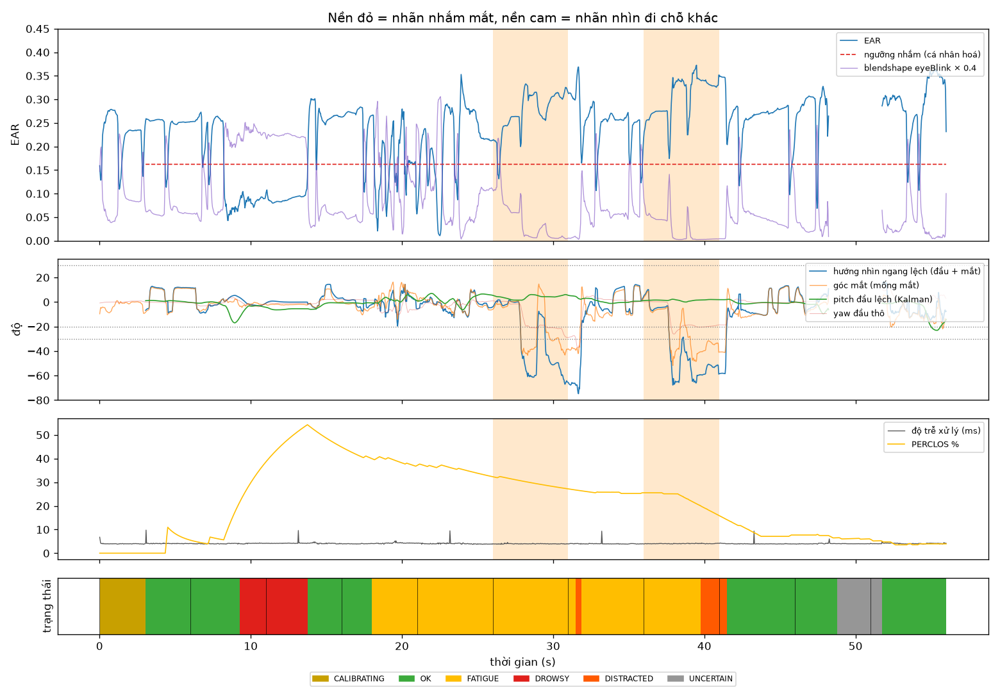

# Kết quả đánh giá: `failure_bach_20261016_195313.mp4`

- 1673 frame, 56.0 s, FPS ghi thực tế 29.8, thấy mặt 93.9% frame, hiệu chuẩn xong lúc 3.0 s

## 1. Mắt nhắm/mở theo frame

Bỏ 0.7 s đầu mỗi đoạn (thời gian phản ứng), bỏ đoạn chớp mắt tự do/ngáp/quay đầu.

| Phương pháp | Precision | Recall | F1 | Accuracy | n frame |
|---|---|---|---|---|---|
| Hệ thống: EAR cá nhân hoá VÀ blendshape (cả 2 mắt) | 0.00 | – | – | 0.78 | 1036 |
| Chỉ blendshape eyeBlink > 0.5 (MediaPipe) | 0.00 | – | – | 0.81 | 1036 |

## 2. Theo sự kiện (cảnh báo có kịp không)

| Đoạn | Mong đợi | Bắt được | Trễ từ lúc có lời nhắc (s) |
|---|---|---|---|
| QUAY HAN SANG BEN (>60 do, nhin ra sau vai) | DISTRACTED | ✅ | 5.49 |
| LIEC MAT sang trai, DAU GIU YEN | DISTRACTED | ✅ | 3.75 |

- Tỉ lệ bắt sự kiện: **100%**; trễ TB buồn ngủ **– s** (gồm ngưỡng 1.0 s + phản ứng người), xao nhãng **4.62 s** (ngưỡng 2.0 s)
- Báo động giả: **1** lần trong 24 s bình thường = 2.50 lần/phút
  - t=9.3s DROWSY trong đoạn "Mo mat, liec mat XUONG dong ho (dau giu yen)"

## 3. Thời gian và độ ổn định

- Độ trễ xử lý frame→quyết định: p50 **4.0 ms**, p95 4.3 ms (riêng model p50 2.9 ms)
- Độ rung góc đầu giữa 2 frame liên tiếp khi ngồi yên (std của chênh lệch): yaw thô 0.04° → Kalman 0.03°; pitch thô 0.09° → Kalman 0.05°

## 4. Từng đoạn (dùng để tìm ca lỗi)

| t (s) | Lời nhắc | Mong đợi | Trạng thái chính | Báo động | Thấy mặt % | EAR TB | % nhắm | \|nhìn ngang\| | pitch đầu | % không chắc | Đạt |
|---|---|---|---|---|---|---|---|---|---|---|---|
| 0 | Nhin thang, mo mat (hieu chuan) | ANY | OK | - | 100 | 0.23 | 3 | 10 | +1 | 0 | – |
| 6 | Mo mat, liec mat XUONG dong ho (dau giu yen) | OK | OK | DROWSY | 100 | 0.13 | 67 | 3 | -5 | 0 | ❌ |
| 11 | Nhin thang | OK | OK | DROWSY | 100 | 0.18 | 48 | 3 | -4 | 0 | ❌ |
| 16 | Lay TAY CHE 1 MAT, mat kia mo | ANY | FATIGUE | - | 100 | 0.19 | 19 | 5 | +1 | 0 | – |
| 21 | Nhin thang | OK | FATIGUE | - | 100 | 0.22 | 14 | 5 | +2 | 0 | ✅ |
| 26 | QUAY HAN SANG BEN (>60 do, nhin ra sau vai) | DISTRACTED | FATIGUE | - | 100 | 0.29 | 0 | 35 | +4 | 0 | ❌ |
| 31 | Nhin thang | OK | FATIGUE | DISTRACTED | 100 | 0.24 | 5 | 10 | +1 | 0 | ❌ |
| 36 | LIEC MAT sang trai, DAU GIU YEN | DISTRACTED | FATIGUE | DISTRACTED | 100 | 0.31 | 0 | 43 | +1 | 0 | ✅ |
| 41 | Nhin thang | OK | OK | - | 100 | 0.25 | 7 | 8 | -1 | 0 | ✅ |
| 46 | LAY TAY CHE CAMERA | ANY | UNCERTAIN | - | 36 | 0.28 | 2 | 5 | -4 | 53 | – |
| 51 | Bo tay ra, nhin thang | OK | OK | - | 99 | 0.29 | 5 | 8 | -7 | 1 | ✅ |

