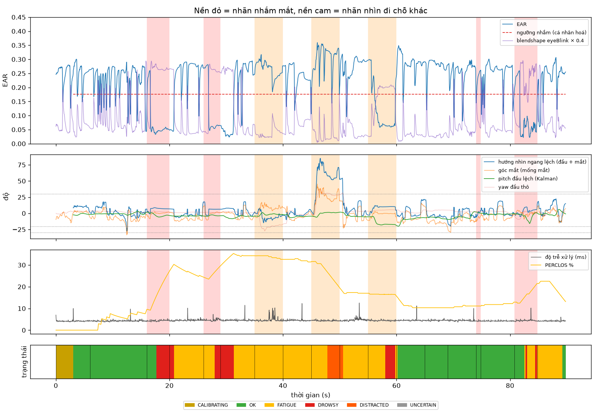

# Kết quả đánh giá: `main_bach_20261016_195131.mp4`

- 2683 frame, 89.8 s, FPS ghi thực tế 29.9, thấy mặt 100.0% frame, hiệu chuẩn xong lúc 3.0 s

## 1. Mắt nhắm/mở theo frame

Bỏ 0.7 s đầu mỗi đoạn (thời gian phản ứng), bỏ đoạn chớp mắt tự do/ngáp/quay đầu.

| Phương pháp | Precision | Recall | F1 | Accuracy | n frame |
|---|---|---|---|---|---|
| Hệ thống: EAR cá nhân hoá VÀ blendshape (cả 2 mắt) | 0.71 | 0.90 | 0.79 | 0.92 | 1481 |
| Chỉ blendshape eyeBlink > 0.5 (MediaPipe) | 0.74 | 0.85 | 0.79 | 0.92 | 1481 |

## 2. Theo sự kiện (cảnh báo có kịp không)

| Đoạn | Mong đợi | Bắt được | Trễ từ lúc có lời nhắc (s) |
|---|---|---|---|
| NHAM MAT 4 giay | DROWSY | ✅ | 1.68 |
| NHAM MAT 3 giay | DROWSY | ✅ | 1.95 |
| NHIN RA BEN TRAI (vat that, khong nhin man hinh) | DISTRACTED | ❌ | – |
| NHIN RA BEN PHAI (vat that, khong nhin man hinh) | DISTRACTED | ✅ | 2.85 |
| CUI XUONG nhin dien thoai tren dui | DISTRACTED | ❌ | – |
| NHAM MAT 4 giay | DROWSY | ✅ | 1.95 |

- Tỉ lệ bắt sự kiện: **67%**; trễ TB buồn ngủ **1.86 s** (gồm ngưỡng 1.0 s + phản ứng người), xao nhãng **2.85 s** (ngưỡng 2.0 s)
- Báo động giả: **0** lần trong 44 s bình thường = 0.00 lần/phút

## 3. Thời gian và độ ổn định

- Độ trễ xử lý frame→quyết định: p50 **4.4 ms**, p95 5.0 ms (riêng model p50 3.1 ms)
- Độ rung góc đầu giữa 2 frame liên tiếp khi ngồi yên (std của chênh lệch): yaw thô 0.11° → Kalman 0.08°; pitch thô 0.14° → Kalman 0.10°

## 4. Từng đoạn (dùng để tìm ca lỗi)

| t (s) | Lời nhắc | Mong đợi | Trạng thái chính | Báo động | Thấy mặt % | EAR TB | % nhắm | \|nhìn ngang\| | pitch đầu | % không chắc | Đạt |
|---|---|---|---|---|---|---|---|---|---|---|---|
| 0 | Nhin thang, mo mat binh thuong (hieu chuan) | ANY | OK | - | 100 | 0.25 | 0 | 10 | -2 | 0 | – |
| 6 | Nhin thang, CHOP MAT tu nhien | OK | OK | - | 100 | 0.22 | 13 | 6 | -1 | 0 | ✅ |
| 16 | NHAM MAT 4 giay | DROWSY | DROWSY | DROWSY | 100 | 0.05 | 100 | 7 | -3 | 0 | ✅ |
| 20 | Mo mat, nhin thang | OK | FATIGUE | DROWSY | 100 | 0.25 | 6 | 4 | -4 | 0 | ❌ |
| 26 | NHAM MAT 3 giay | DROWSY | FATIGUE | DROWSY | 100 | 0.08 | 90 | 6 | -3 | 0 | ✅ |
| 29 | Mo mat, nhin thang | OK | FATIGUE | DROWSY | 100 | 0.18 | 36 | 6 | -6 | 0 | ❌ |
| 35 | NHIN RA BEN TRAI (vat that, khong nhin man hinh) | DISTRACTED | FATIGUE | - | 100 | 0.26 | 0 | 7 | -2 | 0 | ❌ |
| 40 | Nhin thang | OK | FATIGUE | - | 100 | 0.24 | 3 | 3 | -5 | 0 | ✅ |
| 45 | NHIN RA BEN PHAI (vat that, khong nhin man hinh) | DISTRACTED | DISTRACTED | DISTRACTED | 100 | 0.31 | 0 | 62 | +0 | 0 | ✅ |
| 50 | Nhin thang | OK | FATIGUE | - | 100 | 0.27 | 3 | 6 | -4 | 0 | ✅ |
| 55 | CUI XUONG nhin dien thoai tren dui | DISTRACTED | FATIGUE | DROWSY | 100 | 0.10 | 65 | 10 | -16 | 0 | ❌ |
| 60 | Nhin thang | OK | OK | - | 100 | 0.28 | 0 | 8 | -8 | 0 | ✅ |
| 65 | NGAP 1 cai that to | ANY | OK | - | 100 | 0.28 | 0 | 5 | -7 | 0 | – |
| 69 | Nhin thang | OK | OK | - | 100 | 0.25 | 8 | 6 | -5 | 0 | ✅ |
| 74 | Nham mat NHANH roi mo (0.8s) | OK | OK | - | 100 | 0.26 | 0 | 3 | +0 | 0 | ✅ |
| 75 | Mo mat, nhin thang | OK | OK | - | 100 | 0.25 | 8 | 6 | -1 | 0 | ✅ |
| 81 | NHAM MAT 4 giay | DROWSY | FATIGUE | DROWSY | 100 | 0.07 | 82 | 5 | -5 | 0 | ✅ |
| 85 | Mo mat - ket thuc | OK | FATIGUE | - | 100 | 0.25 | 0 | 9 | -0 | 0 | ✅ |

