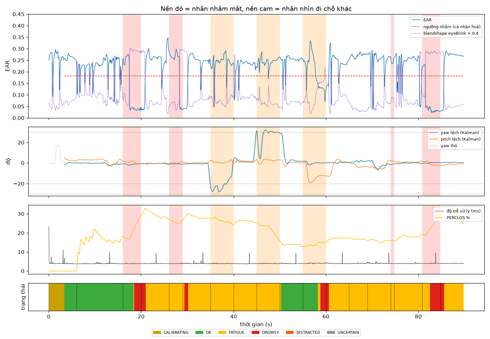

# Kết quả đánh giá: `main_bach_20261016_192527.mp4`

- 2681 frame, 89.8 s, FPS ghi thực tế 29.7, thấy mặt 100.0% frame, hiệu chuẩn xong lúc 3.4 s

## 1. Mắt nhắm/mở theo frame

Bỏ 0.7 s đầu mỗi đoạn (thời gian phản ứng), bỏ đoạn chớp mắt tự do/ngáp/quay đầu.

| Phương pháp | Precision | Recall | F1 | Accuracy | n frame |
|---|---|---|---|---|---|
| EAR + ngưỡng cá nhân hoá (hệ thống) | 0.61 | 0.73 | 0.67 | 0.87 | 1472 |
| Blendshape eyeBlink > 0.5 (MediaPipe) | 0.80 | 0.73 | 0.76 | 0.92 | 1472 |

## 2. Theo sự kiện (cảnh báo có kịp không)

| Đoạn | Mong đợi | Bắt được | Trễ từ lúc có lời nhắc (s) |
|---|---|---|---|
| NHAM MAT 4 giay | DROWSY | ✅ | 2.46 |
| NHAM MAT 3 giay | DROWSY | ✅ | 3.32 |
| QUAY DAU SANG TRAI (nhin cua so) | DISTRACTED | ❌ | – |
| QUAY DAU SANG PHAI | DISTRACTED | ❌ | – |
| CUI XUONG nhin dien thoai | DISTRACTED | ❌ | – |
| NHAM MAT 4 giay | DROWSY | ✅ | 1.73 |

- Tỉ lệ bắt sự kiện: **50%**; trễ TB buồn ngủ **2.50 s** (gồm ngưỡng 1.0 s + phản ứng người), xao nhãng **– s** (ngưỡng 2.0 s)
- Báo động giả: **0** lần trong 44 s bình thường = 0.00 lần/phút

## 3. Thời gian và độ ổn định

- Độ trễ xử lý frame→quyết định: p50 **3.9 ms**, p95 4.1 ms (riêng model p50 2.9 ms)
- Độ rung góc đầu giữa 2 frame liên tiếp khi ngồi yên (std của chênh lệch): yaw thô 0.51° → Kalman 0.53°; pitch thô 0.28° → Kalman 0.24°

## 4. Từng đoạn (dùng để tìm ca lỗi)

| t (s) | Lời nhắc | Mong đợi | Trạng thái chính | Báo động | Thấy mặt % | EAR TB | % nhắm | |yaw| | pitch | % không chắc | Đạt |
|---|---|---|---|---|---|---|---|---|---|---|---|
| 0 | Nhin thang, mo mat binh thuong (hieu chuan) | ANY | CALIBRATING | - | 100 | 0.25 | 0 | 0 | +3 | 0 | – |
| 6 | Nhin thang, CHOP MAT tu nhien | OK | OK | - | 100 | 0.22 | 21 | 1 | +2 | 0 | ✅ |
| 16 | NHAM MAT 4 giay | DROWSY | OK | DROWSY | 100 | 0.09 | 78 | 1 | +0 | 0 | ✅ |
| 20 | Mo mat, nhin thang | OK | FATIGUE | DROWSY | 100 | 0.25 | 11 | 0 | -0 | 0 | ❌ |
| 26 | NHAM MAT 3 giay | DROWSY | FATIGUE | - | 100 | 0.20 | 32 | 1 | +0 | 0 | ❌ |
| 29 | Mo mat, nhin thang | OK | FATIGUE | DROWSY | 100 | 0.23 | 14 | 2 | +0 | 0 | ❌ |
| 35 | QUAY DAU SANG TRAI (nhin cua so) | DISTRACTED | FATIGUE | - | 100 | 0.24 | 9 | 20 | +1 | 0 | ❌ |
| 40 | Nhin thang | OK | FATIGUE | - | 100 | 0.23 | 5 | 4 | +2 | 0 | ✅ |
| 45 | QUAY DAU SANG PHAI | DISTRACTED | FATIGUE | - | 100 | 0.24 | 5 | 28 | +3 | 0 | ❌ |
| 50 | Nhin thang | OK | OK | - | 100 | 0.25 | 7 | 3 | -0 | 0 | ✅ |
| 55 | CUI XUONG nhin dien thoai | DISTRACTED | OK | DROWSY | 100 | 0.19 | 56 | 1 | -14 | 0 | ❌ |
| 60 | Nhin thang | OK | FATIGUE | - | 100 | 0.24 | 12 | 0 | -0 | 0 | ✅ |
| 65 | NGAP 1 cai that to | ANY | FATIGUE | - | 100 | 0.27 | 0 | 2 | -3 | 0 | – |
| 69 | Nhin thang | OK | FATIGUE | - | 100 | 0.24 | 15 | 3 | -3 | 0 | ✅ |
| 74 | Nham mat NHANH roi mo (0.8s) | OK | FATIGUE | - | 100 | 0.26 | 0 | 1 | +2 | 0 | ✅ |
| 75 | Mo mat, nhin thang | OK | FATIGUE | - | 100 | 0.23 | 21 | 0 | +1 | 0 | ✅ |
| 81 | NHAM MAT 4 giay | DROWSY | DROWSY | DROWSY | 100 | 0.04 | 100 | 0 | -1 | 0 | ✅ |
| 85 | Mo mat - ket thuc | OK | FATIGUE | DROWSY | 100 | 0.27 | 2 | 1 | -1 | 0 | ❌ |

